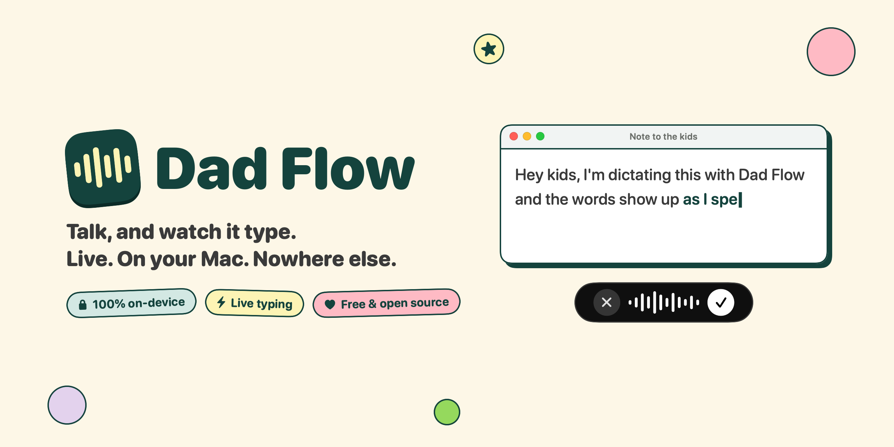
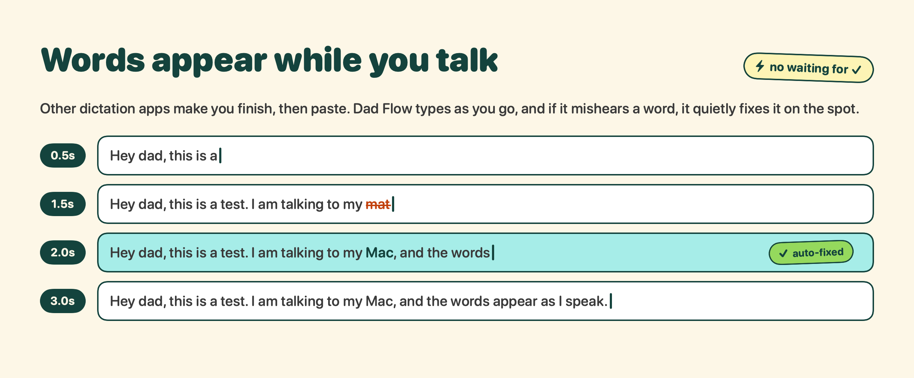
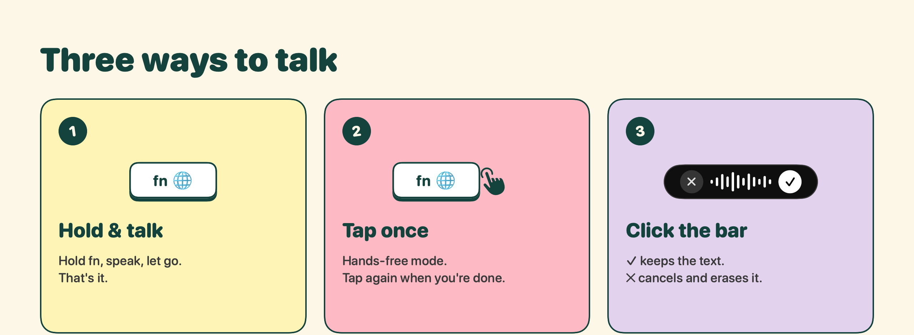
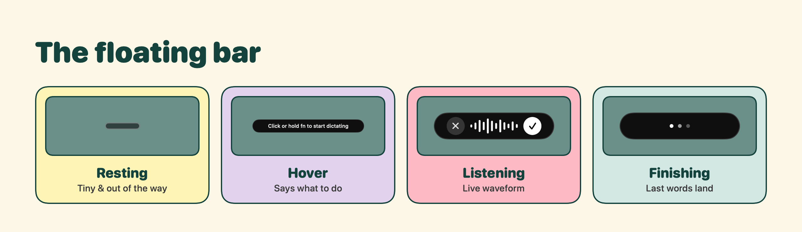
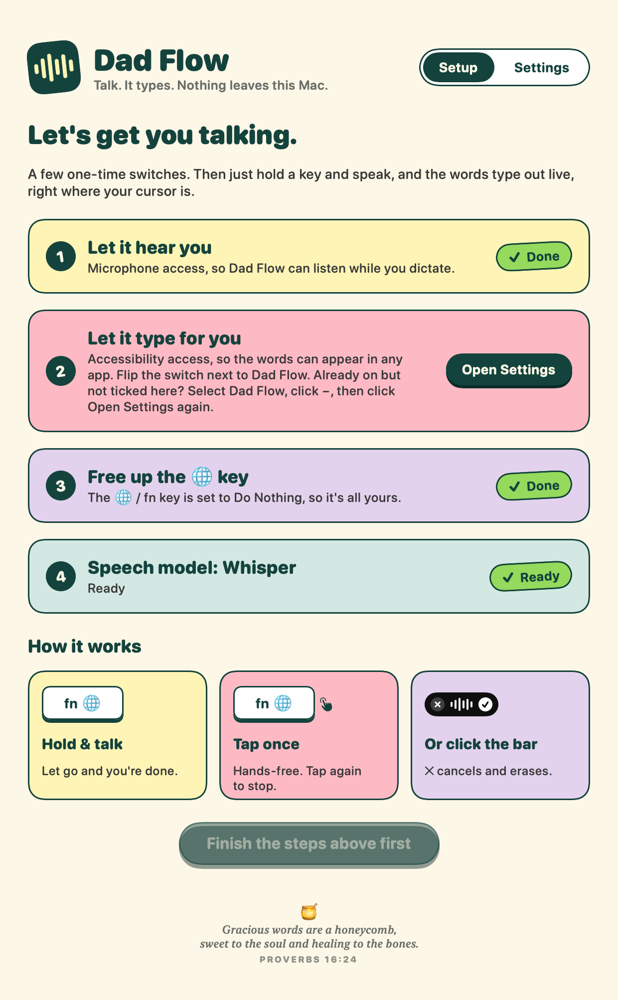
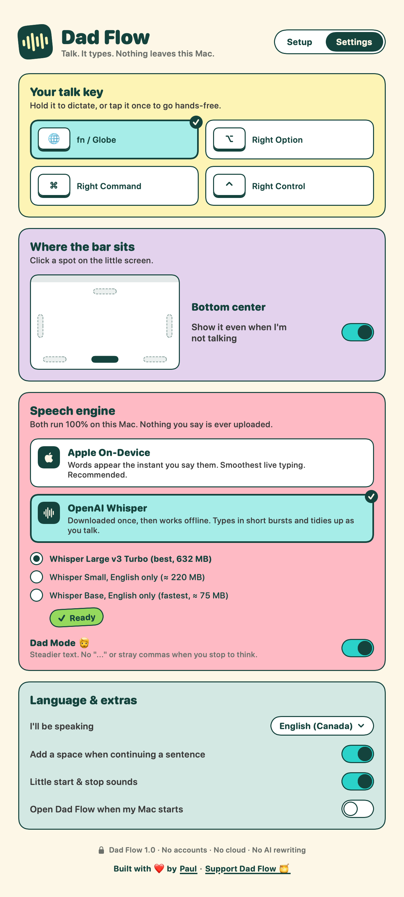
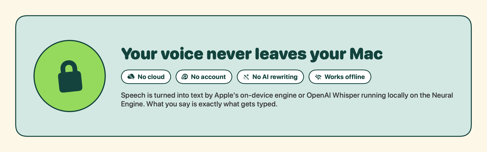
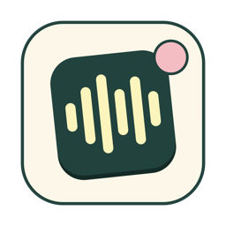

<p align="center">
  
</p>

<p align="center">
  <i>I built this specifically for my dad, who wanted something like Wispr Flow,<br>but where he could see the text appear as he's speaking it.</i>
</p>

<p align="center">
  <b>Free, open-source voice dictation for macOS that types <i>while</i> you talk.</b><br>
  100% on-device · no account · no cloud · no AI rewriting
</p>

<p align="center">
  
  
  
  
  <a href="https://github.com/sponsors/paulkr"></a>
</p>

---

## Why Dad Flow?

Dad wanted dictation that's simple, private, and shows the words **as he says them**, not after he's done talking.

Most dictation apps record, wait for you to stop, send your voice to a server, rewrite it with AI, and *then* paste. Dad Flow skips all of that. The text appears as you speak, wherever your cursor is, and it's exactly what you said.

<p align="center">
  
</p>

## Features

- ⚡️ **Live typing.** Words appear in any app while you speak. If the recognizer revises a word ("my mat" → "my Mac"), Dad Flow backspaces just that part and fixes it.
- 🔒 **Fully local.** Audio never leaves your Mac. There's no account, no telemetry, and it works offline.
- 🧔 **Dad Mode** (Whisper). Pausing to think won't scatter "..." or stray commas into your text. Punctuation only appears once Whisper is sure of it. On by default.
- 🗣️ **Two on-device engines:**
  - **Apple On-Device** (macOS 26+): Apple's new `SpeechAnalyzer`, which streams word-by-word. Built into macOS, so nothing to download.
  - **OpenAI Whisper** (large-v3-turbo, small, or base) via [WhisperKit](https://github.com/argmaxinc/WhisperKit) on the Neural Engine. The model downloads once, then works offline.
- ✋ **Natural controls.** Hold `fn` to talk, tap it once for hands-free, or click the floating bar.
- 📍 **Movable bar.** Put it at the bottom, top, left edge, right edge, or either bottom corner.
- ✍️ **No AI rewriting.** What you say is what gets typed. The only tweaks are smart spacing (adding a space when you continue a sentence) and Dad Mode, and you can turn both off.
- 🧓 **Friendly setup.** A big, colourful setup screen walks through each permission.

<p align="center">
  
</p>

<p align="center">
  
</p>

## Screenshots

<table>
  <tr>
    <td width="50%"></td>
    <td width="50%"></td>
  </tr>
  <tr>
    <td align="center"><b>Setup</b>: one sticker card per step</td>
    <td align="center"><b>Settings</b>: keycaps, a click-to-place screen, big toggles</td>
  </tr>
</table>

## Install

1. Download `DadFlow-x.y.dmg` from the **Releases** page (or [build it yourself](#build-from-source)).
2. Open the DMG and drag **Dad Flow** into **Applications**.
3. Open it. Release builds are ad-hoc signed, not notarized, so macOS will say it can't verify the developer.
   Click **Done**, then go to **System Settings → Privacy & Security** and click **Open Anyway**. You only need to do this once.
4. Follow the setup screen:
   - **Microphone**: so it can hear you.
   - **Accessibility**: so it can type into other apps and detect the `fn` key.
   - **The 🌐 key**: set *System Settings → Keyboard → Press 🌐 key to → **Do Nothing*** (or pick a different talk key).

### Requirements

| | |
|---|---|
| Mac | Apple Silicon (M1 or newer) |
| macOS | 14 Sonoma or newer · **macOS 26+** for the Apple engine (older versions use Whisper automatically) |
| Disk | ~3 MB for the app, plus 75–632 MB if you use Whisper |

<p align="center">
  
</p>

## Build from source

You need the Xcode **Command Line Tools** (full Xcode isn't required).

```sh
git clone <this repo>
cd dadflow
./scripts/build-dmg.sh          # → dist/DadFlow-1.0.dmg  (and dist/Dad Flow.app)
```

For development:

```sh
swift build
.build/debug/DadFlow                                     # run the menu-bar app

# Stream an audio file through an engine and watch the live transcript
say -o /tmp/t.wav --data-format=LEI16@16000 "Testing one two three"
.build/debug/DadFlow --selftest /tmp/t.wav apple         # or: whisper, whisper-dad (Dad Mode)

# Re-render the README graphics and settings screenshots
.build/debug/DadFlow --render-docs docs/images
```

> **Tip:** macOS ties Accessibility permission to the app's code signature. Each ad-hoc rebuild looks like a "new" app, so you may need to toggle Dad Flow off and on in *Privacy & Security → Accessibility* after rebuilding.

## How it works

```
 fn key / click ─▶ HotkeyMonitor ─▶ DictationController ─▶ AudioCapture (AVAudioEngine)
                                          │                        │
                                          │                        ▼
                                          │           TranscriptionEngine (streaming)
                                          │           ├─ AppleSpeechEngine  (SpeechAnalyzer, volatile → final)
                                          │           └─ WhisperEngine      (re-decode window every ~0.4 s,
                                          │                                  confirm all but last segment)
                                          ▼                        │ full transcript so far
                                    OverlayController              ▼
                                    (floating bar)            LiveTyper ─▶ diff vs. typed text
                                                                        ─▶ backspace the changed tail
                                                                        ─▶ type the new chars (CGEvent)
```

| Piece | File |
|---|---|
| Hotkey (hold = push-to-talk, tap = hands-free) | [`App/HotkeyMonitor.swift`](Sources/DadFlow/App/HotkeyMonitor.swift) |
| Session state machine | [`App/DictationController.swift`](Sources/DadFlow/App/DictationController.swift) |
| Live typing with in-place corrections | [`Typing/LiveTyper.swift`](Sources/DadFlow/Typing/LiveTyper.swift) |
| Apple on-device engine | [`Engines/AppleSpeechEngine.swift`](Sources/DadFlow/Engines/AppleSpeechEngine.swift) |
| Whisper streaming engine | [`Engines/WhisperEngine.swift`](Sources/DadFlow/Engines/WhisperEngine.swift) |
| Model download & loading | [`Engines/ModelManager.swift`](Sources/DadFlow/Engines/ModelManager.swift) |
| Floating bar (non-activating panel) | [`UI/Overlay.swift`](Sources/DadFlow/UI/Overlay.swift) |
| Setup & Settings window | [`UI/SettingsView.swift`](Sources/DadFlow/UI/SettingsView.swift) |

Whisper models are stored in `~/Library/Application Support/DadFlow/Models`.

## Design

The settings window uses a **retro soda-shop** theme: a cream canvas, deep-teal ink, fruit-coloured "sticker" cards with solid outlines instead of shadows, and chunky pill buttons that squish when pressed. Everything is drawn in SwiftUI. The README graphics are rendered by the app itself (`--render-docs`), so they always match.

| Token | Hex | Used for |
|---|---|---|
| Canvas | `#FDF7E7` | window background |
| Ink | `#14433D` | headlines, outlines, primary buttons |
| Lemon · Cherry · Lavender · Mint | `#FDF4B5` `#FEBAC4` `#E3D2ED` `#D3E8E3` | section cards |
| Aqua | `#2AD2C9` | toggles & selected states |
| Lime | `#95D95D` | "Done" chips |

## Contributing

Issues and pull requests are welcome. Ideas that fit the spirit of the project:

- More languages in the picker
- A custom-vocabulary list (names, places)
- Intel / universal builds
- Developer ID signing & notarization in CI

Please keep it **local-only** and **simple enough for a dad**.

## Support Dad Flow

Dad Flow is free and always will be. If it saves you some typing and you'd like to say thanks, you can [**sponsor me on GitHub**](https://github.com/sponsors/paulkr) 🍯. It helps cover the Apple developer fee, which would let future releases open without the "Open Anyway" step.

<p align="center">
  <a href="https://github.com/sponsors/paulkr"></a>
</p>

## Acknowledgements

- [WhisperKit](https://github.com/argmaxinc/WhisperKit) by Argmax (MIT), which runs Whisper on Apple Silicon
- [OpenAI Whisper](https://github.com/openai/whisper) (MIT) for the speech recognition models
- Apple's Speech framework for the on-device `SpeechAnalyzer`

Dad Flow is an independent project. It isn't affiliated with or endorsed by Wispr, OpenAI, or Apple.

## License

Copyright © 2026 Dad Flow contributors.

Dad Flow is free software: you can redistribute it and/or modify it under the terms of the **GNU General Public License v3.0** as published by the Free Software Foundation. See [`LICENSE`](LICENSE) for the full text. Licenses for bundled dependencies (MIT / Apache-2.0, all GPLv3-compatible) are in [`THIRD_PARTY_NOTICES.md`](THIRD_PARTY_NOTICES.md).

This program is distributed in the hope that it will be useful, but **without any warranty**; without even the implied warranty of merchantability or fitness for a particular purpose.

<p align="center">
  <br>
  <sub>Made with ❤️ for Dad.</sub>
</p>
